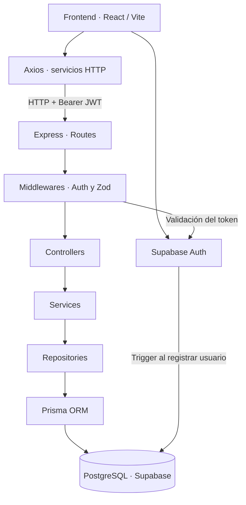

<div align="center">
  <a href="https://github.com/valenvitale/finzo">
    
  </a>
  <h1>Finzo</h1>
  <p><strong>Sistema de gestión de finanzas personales</strong></p>
  <p>Registrá tus ingresos y gastos, organizá tus movimientos y comprendé tus finanzas.</p>
  <p>Proyecto Integrador · Metodología de Sistemas II · Tecnicatura Universitaria en Programación · 2026</p>
  <p>
    
    
    
    
    
    
    
  </p>
</div>

## Índice

- [Descripción y alcance](#descripción-y-alcance)
- [Tecnologías](#tecnologías)
- [Instalación y ejecución local](#instalación-y-ejecución-local)
- [Arquitectura](#arquitectura)
- [Estructura del repositorio](#estructura-del-repositorio)
- [API REST](#api-rest)
- [Pruebas automatizadas](#pruebas-automatizadas)
- [Calidad del código](#calidad-del-código)
- [Flujo de trabajo](CONTRIBUTING.md)
- [Documentación complementaria](#documentación-complementaria)
- [Equipo](#equipo)

## Descripción y alcance

**Finzo** es una aplicación web de finanzas personales dirigida a personas que necesitan registrar y comprender sus ingresos y gastos sin recurrir a herramientas contables complejas ni conectar sus cuentas bancarias. Buscamos centralizar la información financiera y facilitar su consulta mediante categorías, filtros, monedas e indicadores.

### Funcionalidades

| Módulo | Alcance actual |
| --- | --- |
| Autenticación | Registro, inicio y cierre de sesión mediante Supabase Auth y acceso a rutas protegidas. |
| Perfil | Gestión de datos del perfil y preferencias de monedas. |
| Movimientos | Creación, edición y eliminación de ingresos y gastos. Listado con filtros y paginación. |
| Categorías | Categorías del sistema y gestión de categorías personalizadas. |
| Medios de pago | Consulta y gestión de medios de pago del usuario; los globales son de solo lectura para los usuarios. |
| Resumen financiero | Consulta de ingresos, gastos y balance del período; dashboard de la aplicación. |
| Estadísticas | Estadísticas por moneda, distribución de gastos por categoría, evolución mensual, promedio de gasto diario y tasa de ahorro. |
| Presupuestos | Límites mensuales de gasto por categoría y moneda, con seguimiento visual. |
| Metas de ahorro | Seguimiento de metas mensuales por moneda. |

**Reglas de dominio clave:**
* Los movimientos se registran en una moneda y su tipo se determina a partir de la categoría.
* Los ingresos no llevan medio de pago (se normalizan a `null`); los gastos requieren uno válido.
* El sistema contempla **ARS**, **USD** y **EUR** como monedas iniciales y **no suma importes de monedas distintas** en las estadísticas.

> [!NOTE]
> **Alcance de la entrega (Taller III):** Priorizamos completar y estabilizar las funcionalidades existentes, documentar la configuración y verificar el comportamiento del sistema mediante pruebas automatizadas y análisis estático local. La integración continua (CI/CD), el despliegue productivo y las exportaciones CSV permanecen fuera del alcance actual por decisión del equipo.

## Tecnologías

| Área | Tecnologías principales |
| --- | --- |
| Frontend | React 19, TypeScript, Vite 8, Tailwind CSS 4, React Router, Axios, Sonner y Lucide React. |
| Backend | Node.js 24, Express 5, TypeScript, Zod 4 y Prisma 7.10.0 con adaptador PostgreSQL. |
| Datos y autenticación | PostgreSQL alojado en Supabase, Supabase Auth y políticas Row Level Security (RLS). |
| Testing | Vitest 5, Supertest, React Testing Library y jsdom. |
| Calidad | ESLint 10, Prettier 3 y compilación con TypeScript. |
| Gestión del código | Git, GitHub, Jira y pnpm workspaces. |

Las versiones exactas de las dependencias resueltas se encuentran en [`pnpm-lock.yaml`](pnpm-lock.yaml). Los manifiestos de cada workspace declaran las dependencias y sus rangos: [`backend/package.json`](backend/package.json) y [`frontend/package.json`](frontend/package.json).

## Instalación y ejecución local

### 1. Requisitos previos

* **Git**
* **Node.js 24 o superior** según `engines` del proyecto. Recomendamos la versión principal indicada en [`.nvmrc`](.nvmrc) (`24`). La verificación se hizo con `24.16.0`.
* **pnpm** instalado (verificado con `12.4.1`).
* **Un proyecto de Supabase accesible**, con PostgreSQL y autenticación por correo electrónico y contraseña habilitada (para una instalación independiente, usar un proyecto de desarrollo propio).
* **Puertos locales disponibles:** `3000` (backend) y `5173` (frontend).

### 2. Clonar e instalar dependencias

```bash
git clone https://github.com/valenvitale/finzo.git
cd finzo
git switch develop
pnpm install --frozen-lockfile
```

El comando instala desde la raíz las dependencias de `frontend` y `backend` con las versiones registradas en `pnpm-lock.yaml`.

### 3. Configurar el entorno

Crear los archivos `.env` a partir de las plantillas versionadas en el repositorio:

**Windows (PowerShell):**
```powershell
Copy-Item backend/.env.example backend/.env
Copy-Item frontend/.env.example frontend/.env
```

**Linux, macOS o Git Bash:**
```bash
cp backend/.env.example backend/.env
cp frontend/.env.example frontend/.env
```

Completar ambos archivos apuntando al **mismo proyecto de Supabase** (siguiendo el formato de ejemplo definido en `backend/.env.example` y `frontend/.env.example`):

**Backend (`backend/.env`):**
```dotenv
PORT=3000
NODE_ENV=development
CLIENT_URL=http://localhost:5173
SUPABASE_URL=https://tu-proyecto.supabase.co
SUPABASE_ANON_KEY=<tu-anon-key>
SUPABASE_SERVICE_ROLE_KEY=<tu-service-role-key>
DATABASE_URL="<cadena-de-conexion-pooler-modo-transaccion-puerto-6543>"
DIRECT_URL="<cadena-de-conexion-pooler-modo-sesion-puerto-5432>"
```

| Variable | Propósito |
| ------ | ------ |
| `PORT` | Puerto HTTP del backend. Predeterminado: `3000`. |
| `NODE_ENV` | Entorno de ejecución: `development`, `production` o `test`. |
| `CLIENT_URL` | Origen permitido por la configuración CORS. |
| `SUPABASE_URL` | URL del proyecto Supabase. |
| `SUPABASE_ANON_KEY` | Clave pública de acceso a Supabase. |
| `SUPABASE_SERVICE_ROLE_KEY` | Clave privilegiada de uso exclusivo del backend. |
| `DATABASE_URL` | Conexión de la aplicación a PostgreSQL mediante el pooler en modo transacción (`?pgbouncer=true`). |
| `DIRECT_URL` | Conexión en modo sesión utilizada por Prisma CLI para ejecutar migraciones. |

**Frontend (`frontend/.env`):**
```dotenv
VITE_API_URL=http://localhost:3000/api
VITE_SUPABASE_URL=https://tu-proyecto.supabase.co
VITE_SUPABASE_ANON_KEY=<tu-anon-key>
```

> [!IMPORTANT]
> Nunca versionar archivos `.env` reales ni credenciales. Las variables `VITE_*` quedan expuestas en el navegador: jamás incluir en ellas la contraseña de la base de datos ni la clave `service_role`. Si se modifica el puerto del frontend o del backend, actualizar las URL correspondientes.

### 4. Preparar la base de datos

> [!WARNING]
> Si la base ya existe, consultar la [precaución al migrar una base existente](docs/configuracion-supabase.md#precaución-al-migrar-una-base-existente) antes de ejecutar `prisma migrate deploy`. La segunda migración se detiene si ya existen presupuestos. No reiniciar ni borrar una base compartida.

Desde la raíz del repositorio, ingresar al workspace `backend`, generar el cliente Prisma y aplicar las migraciones:

```bash
cd backend
pnpm exec prisma generate
pnpm exec prisma migrate deploy
```

* `prisma generate` genera el cliente tipado a partir del esquema actual (no modifica la base de datos).
* `prisma migrate deploy` aplica las migraciones pendientes versionadas (incluidas `20261126000100_agregar_presupuestos` y `20261126000200_metas_ahorro_moneda`).

A continuación, seguir la [guía de configuración de Supabase](docs/configuracion-supabase.md) para crear la función y el *trigger* de registro de perfiles y configurar las políticas RLS. La guía conserva las definiciones verificadas antes de incorporar presupuestos y metas de ahorro. Como las migraciones de esos módulos no habilitan RLS explícitamente, verificar las políticas efectivas de ambas tablas.

Luego, cargar los datos iniciales desde `backend/`:

```bash
pnpm exec prisma db seed
cd ..
```

El *seed* carga tres monedas (`ARS`, `USD`, `EUR`), once categorías globales y cuatro medios de pago globales (`Efectivo`, `Tarjeta de Débito`, `Tarjeta de Crédito` y `Transferencia`). No crea usuarios ni movimientos y es idempotente en condiciones normales.

### 5. Iniciar la aplicación

Desde la raíz del proyecto:

```bash
pnpm dev
```

| Servicio | Dirección local |
| ------ | ------ |
| **Frontend** | http://localhost:5173 |
| **Backend (comprobación HTTP)** | http://localhost:3000/ |
| **API REST (prefijo)** | http://localhost:3000/api |

*(Opcional)* Para ver los logs por separado en dos terminales: `pnpm --filter backend dev` y `pnpm --filter frontend dev`.

Para validar el funcionamiento, abrir el frontend, registrar un usuario (confirmar correo si Supabase lo requiere), iniciar sesión, configurar monedas desde el perfil y registrar un movimiento. *(La ruta raíz del backend solo confirma que el servidor HTTP responde; no verifica por sí sola la conexión a PostgreSQL).*

Si el `build` informa que faltan campos de Prisma o hay desajuste de tipos con el esquema, regenerar el cliente:

```bash
pnpm --filter backend exec prisma generate
pnpm build
```

> [!NOTE]
> **Estado de verificación:** El 24/11/2026 comprobamos la generación del cliente Prisma y la compilación en el entorno de desarrollo existente. La instalación completa desde un clon limpio contra una instancia nueva de Supabase aún debe verificarse siguiendo estos pasos.

## Arquitectura

Organizamos Finzo como una aplicación cliente-servidor en un monorepositorio. El frontend consume una API REST y utiliza Supabase Auth para gestionar la sesión. El backend valida las peticiones, aplica las reglas de negocio y accede a PostgreSQL mediante Prisma.



En el backend, las rutas configuran las dependencias y middlewares; los controladores coordinan HTTP; los servicios contienen las reglas de negocio y los repositorios encapsulan la persistencia y los mapeos. El manejo global de errores se registra al final de Express. En el frontend separamos páginas, componentes presentacionales, hooks y servicios HTTP; `AuthContext` centraliza la sesión y `useApi` reutiliza el manejo de datos, carga, errores y reintentos explícitos mediante `refetch`.

### Decisiones de diseño

Aplicamos SRP y DIP para separar responsabilidades y reducir el acoplamiento. En el módulo de movimientos, por ejemplo, el controlador recibe `IMovimientoService` y el servicio recibe interfaces de repositorios por constructor. Las rutas actúan como punto de composición de esas dependencias. Los repositorios transforman los modelos de persistencia a DTO y reutilizan la configuración de Prisma. El costo es incorporar interfaces y mapeos adicionales; el beneficio es poder reemplazar colaboradores en pruebas y mantener las capas por separado.

Documentamos el contexto, las alternativas, los cambios y sus costos en [Decisiones de diseño y registro de refactorización](docs/decisiones-diseno.md). Allí también explicamos por qué evitamos incorporar patrones sin una necesidad concreta.

### Modelo de datos

El esquema de Prisma incluye ocho modelos: `Perfil`, `Moneda`, `PerfilMoneda`, `Categoria`, `MedioPago`, `Movimiento`, `Presupuesto` y `MetaAhorro`. Cada presupuesto pertenece a un perfil, una categoría y una moneda; su límite mensual es un `Decimal(12,2)` y la combinación perfil/categoría/moneda/mes/año es única. Cada meta de ahorro tiene un monto `Decimal(12,2)` y es única por perfil, moneda, mes y año. Consultar el [esquema Prisma](backend/prisma/schema.prisma) y las migraciones para conocer las relaciones y restricciones exactas.

### Autenticación y autorización

Supabase Auth gestiona el registro y la sesión. El frontend incorpora el token de acceso a las peticiones mediante un interceptor de Axios. El middleware del backend comprueba el token con `supabase.auth.getUser(token)` y asigna la identidad autenticada a `req.user`. Las rutas protegidas del frontend mejoran la navegación, pero los controles de acceso efectivos corresponden al backend y a la base de datos.

En movimientos, el servicio comprueba la pertenencia de los registros y el repositorio filtra el listado por perfil. Configuramos RLS sobre `perfiles`, `movimientos`, `categorias`, `medios_de_pago` y `perfiles_monedas`, permitiendo a los usuarios autenticados consultar categorías y medios globales sin modificarlos mediante esas políticas. El trigger de registro crea automáticamente el perfil correspondiente a cada nuevo usuario de Auth.

Las políticas RLS no sustituyen los controles del backend: las conexiones privilegiadas pueden eludirlas. Verificamos la existencia de las políticas originales y algunos controles de autorización mediante tests con mocks, pero aún no realizamos una prueba integral de aislamiento contra una instancia real de Supabase. La configuración RLS de `presupuestos` y `metas_ahorro` debe verificarse por separado; el esquema Prisma no prueba que RLS esté habilitado. La configuración y sus límites se detallan en la [guía de Supabase](docs/configuracion-supabase.md).

## Estructura del repositorio

```text
finzo/
├── backend/
│   ├── prisma/                  # Esquema, migraciones y seed
│   ├── src/
│   │   ├── config/              # Entorno, Prisma y Supabase
│   │   ├── controllers/         # Entrada y salida HTTP
│   │   ├── errors/              # Errores de aplicación
│   │   ├── middlewares/         # Autenticación, validación y errores
│   │   ├── repositories/        # Acceso a datos y mapeos
│   │   ├── routes/              # Endpoints y composición
│   │   ├── services/            # Reglas de negocio
│   │   ├── types/               # Contratos y DTO
│   │   ├── validation/          # Esquemas Zod
│   │   ├── app.ts               # Configuración de Express
│   │   └── server.ts            # Inicio del servidor
│   ├── tests/                   # Pruebas unitarias y de integración
│   ├── .env.example
│   └── prisma.config.ts
├── frontend/
│   ├── public/images/           # Recursos visuales de FINZO
│   ├── src/
│   │   ├── components/          # Componentes visuales reutilizables
│   │   ├── context/             # Estado de autenticación
│   │   ├── hooks/               # Lógica reutilizable
│   │   ├── pages/               # Pantallas de la aplicación
│   │   ├── routes/              # Navegación y protección de rutas
│   │   ├── services/            # Cliente HTTP y servicios
│   │   ├── styles/              # Estilos y tokens visuales
│   │   ├── types/               # Tipos del frontend
│   │   └── utils/               # Formateadores y utilidades
│   ├── tests/                   # Pruebas unitarias y de integración
│   └── .env.example
├── docs/                        # Documentación técnica complementaria
├── eslint.config.js             # Análisis estático compartido
├── .prettierrc                  # Convenciones de formato
├── package.json                 # Scripts comunes
├── pnpm-workspace.yaml          # Workspaces
├── pnpm-lock.yaml               # Dependencias resueltas
├── PROPUESTA.md                 # Propuesta del proyecto
└── README.md                    # Punto de entrada
```

## API REST

La API utiliza JSON y concentra sus módulos bajo `/api`. Para las operaciones protegidas se envía el encabezado `Authorization: Bearer <access_token>`.

| Ruta base | Responsabilidad |
| --- | --- |
| `/api/perfil` | Perfil del usuario. |
| `/api/monedas` | Catálogo de monedas. |
| `/api/perfil/monedas` | Monedas asociadas al perfil. |
| `/api/movimientos` | Ingresos y gastos. |
| `/api/categorias` | Categorías de movimientos. |
| `/api/medios-pago` | Medios de pago. |
| `/api/resumen` | Resumen financiero. |
| `/api/estadisticas` | Estadísticas financieras. |
| `/api/presupuestos` | Gestión de presupuestos y seguimiento de ahorro (módulo incorporado en PR #35). |

Por ejemplo, `GET /api/resumen?mes=10&anio=2026` devuelve un resumen correspondiente al período solicitado. Las pruebas de integración verifican una respuesta como esta (datos ficticios):

```json
{
  "exito": true,
  "datos": {
    "totalIngresos": 1000,
    "totalGastos": 300,
    "balance": 700,
    "moneda": "ARS"
  }
}
```

Una petición sin token a ese endpoint devuelve HTTP 401. Un mes inválido devuelve HTTP 400 antes de consultar los repositorios. La definición real de rutas se encuentra en [`backend/src/routes/`](backend/src/routes/) y los esquemas de entrada en [`backend/src/validation/`](backend/src/validation/). Esta sección es un mapa general, no un contrato exhaustivo. La [referencia de la API REST](docs/API.md) documenta las 27 operaciones de los nueve módulos, incluidos presupuestos y metas de ahorro, con sus entradas, respuestas, validaciones y límites de verificación.

## Pruebas automatizadas

Utilizamos Vitest en ambos workspaces. En el backend ejecutamos pruebas en Node.js y utilizamos Supertest para comprobar la integración HTTP. En el frontend usamos React Testing Library y jsdom para probar componentes y hooks. Los mocks permiten controlar las dependencias externas y reproducir escenarios sin conectarse necesariamente a una base real.

```bash
pnpm test                         # Suite completa
pnpm --filter backend test        # Solo backend
pnpm --filter frontend test       # Solo frontend
```

### Resultado registrado el 27/11/2026

| Workspace | Archivos aprobados | Pruebas aprobadas | Pruebas fallidas |
| --- | ---: | ---: | ---: |
| Backend | 29 | 189 | 0 |
| Frontend | 15 | 35 | 0 |
| **Total** | **44** | **224** | **0** |

Es una evidencia de la ejecución local realizada en `develop` (`d70bb6d`), no un contador dinámico ni una garantía de resultados en futuras revisiones. El 100 % de aprobación no equivale a cobertura total del código; no medimos un porcentaje de cobertura en esta revisión.

### Casos representativos

| Caso | Tipo | Qué verificamos y por qué |
| --- | --- | --- |
| Tasa de ahorro del 70 % con ingresos de 100.000 y gastos de 30.000 | Normal | Exactitud de un cálculo financiero relevante. |
| Estadísticas sin movimientos | Límite | Respuesta con un arreglo vacío para usuarios sin datos. |
| Ingreso sin medio de pago | Límite | El servicio normaliza el medio a `null`, incluso si recibe otro valor. |
| Gasto sin medio de pago | Error | Rechazo de una operación que incumple una regla de negocio. |
| Edición o eliminación de un movimiento ajeno | Error | Rechazo del acceso a datos de otro perfil en el servicio. |
| Resumen válido (1.000 de ingresos y 300 de gastos) | Normal | HTTP 200, balance 700 y filtros correctos enviados al repositorio. |
| Mes 18 o token ausente en resumen | Error | HTTP 400 o 401, sin consultar los repositorios. |
| Repetición de consulta y fallo en `useApi` | Normal / error | Reutilización de argumentos y gestión del estado de error y carga. |
| Filtros de movimientos con rangos válidos, iguales e invertidos | Normal / límite / error | HTTP 200 para rangos válidos e iguales y HTTP 400 para rangos invertidos o parámetros no admitidos. |
| Fecha de movimiento anterior, actual o futura | Normal / límite / error | Aceptación de ayer y hoy; rechazo de fechas futuras, con reloj controlado en los tests. |
| Movimientos recientes en ARS, USD y EUR | Regresión | Cada importe se presenta con su moneda; un código desconocido no se representa como ARS. |

Código de las pruebas seleccionadas: [estadísticas](backend/tests/unit/estadisticas.service.test.ts), [movimientos](backend/tests/unit/movimiento.service.test.ts), [resumen HTTP](backend/tests/integration/resumen.routes.test.ts) y [useApi](frontend/tests/unit/useApi.test.ts).

En la prueba de integración de resumen, el controlador, el servicio y los middlewares son reales, pero simulamos Supabase Auth y los repositorios. Las pruebas verifican las capas y reglas bajo condiciones controladas; no prueban por sí solas las políticas RLS reales ni el recorrido completo de un usuario en el navegador. Queda pendiente comprobar los escenarios de respuestas fuera de orden y desmontaje en `useApi`.

## Calidad del código

### Scripts disponibles

Ejecutar desde la raíz del repositorio:

| Comando | Función |
| --- | --- |
| `pnpm dev` | Iniciar frontend y backend en desarrollo. |
| `pnpm build` | Compilar TypeScript y construir ambos workspaces. |
| `pnpm test` | Ejecutar las suites de pruebas. |
| `pnpm lint` | Analizar el código con ESLint. |
| `pnpm format:check` | Verificar el formato sin modificar archivos. |
| `pnpm format` | Aplicar Prettier a los archivos incluidos en su configuración. |

ESLint utiliza una configuración común y reglas específicas para React y Node.js. Prettier establece comillas simples, punto y coma, sangría de dos espacios y ancho preferido de 120 caracteres. Los archivos [`eslint.config.js`](eslint.config.js) y [`.prettierrc`](.prettierrc) son la referencia de las reglas aplicadas.

### Evidencia de revisión — 27/11/2026

| Verificación | Resultado registrado |
| --- | --- |
| `pnpm test` | 224 pruebas aprobadas en 44 archivos. |
| `pnpm lint` | Sin errores ni advertencias. |
| `pnpm format:check` | Última revisión (24/11): 91 archivos con diferencias de formato. Pendiente de repetir sobre la versión actual. |
| `pnpm build` | Backend y frontend compilaron correctamente. Vite emitió una advertencia por tamaño de chunk (1.092,75 kB minificados; 310,95 kB gzip). |

Detectamos errores de compilación asociados a tipos del cliente Prisma desactualizado (campo `icono` y medio de pago nullable). Regeneramos el cliente con `prisma generate` y repetimos el build, que terminó correctamente sin modificar el código fuente. Incorporamos ese paso a la instalación como medida preventiva.

La advertencia de ESLint fue resuelta en la PR #34. Las diferencias de formato y la optimización del tamaño del bundle siguen pendientes. Proponemos coordinar el formateo masivo en una tarea independiente para evitar cambios innecesarios en ramas de otros integrantes. No consideramos el proyecto libre de advertencias ni completamente optimizado.

## Documentación complementaria

| Documento | Contenido |
| --- | --- |
| [Propuesta del proyecto](PROPUESTA.md) | Objetivos y planificación original; no representa por sí sola el estado actual. |
| [Guía de contribución](CONTRIBUTING.md) | Flujo de trabajo, ramas y revisión de cambios. |
| [API REST](docs/API.md) | Contratos HTTP, entradas, respuestas, validaciones y errores. |
| [Configuración de Supabase](docs/configuracion-supabase.md) | Preparación de Auth, trigger de perfiles y políticas RLS. |
| [Decisiones de diseño](docs/decisiones-diseno.md) | Problemas, alternativas, refactorizaciones, costos y evidencias históricas. |
| [Guía de desarrollo frontend](docs/guia-frontend.md) | Convenciones visuales, componentes, hooks y organización del frontend. |
| [Hoja de ruta de mejoras](docs/mejoras-pendientes.md) | Registro actualizado de mejoras pendientes al cierre del Sprint 3. |
| [Controlador de resumen anterior](docs/resumen-controller.md) y [rutas anteriores](docs/resumen.routes.md) | Material histórico para comparar el antes y el después de la refactorización. |

Mantenemos el README como punto de entrada y la documentación complementaria como referencia especializada. Cuando modificamos una funcionalidad o configuración, revisamos también los documentos que la describen.

## Equipo

Grupo 1 — Metodología de Sistemas II (2026).

| Integrante | GitHub | Rol |
| --- | --- | --- |
| Federico Heinrich | [@fedeheinrich](https://github.com/fedeheinrich) | Fullstack Developer |
| Máximo Messina | [@maxemessina](https://github.com/maxemessina) | Fullstack Developer |
| Valentina Vitale | [@valenvitale](https://github.com/valenvitale) | Fullstack Developer |
| Alessio Cragno | [@alesiocragno](https://github.com/alesiocragno) | Fullstack Developer |

Proyecto académico. Consultar [`LICENSE`](LICENSE) para conocer las condiciones de licencia del repositorio.
